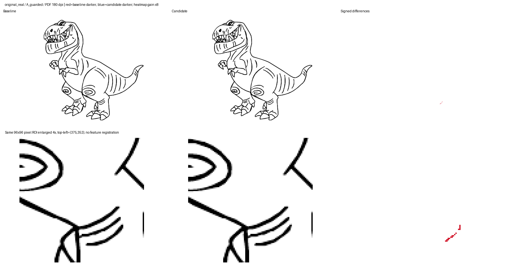
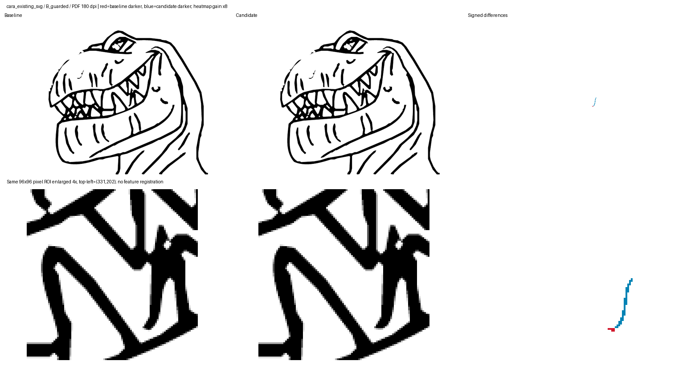
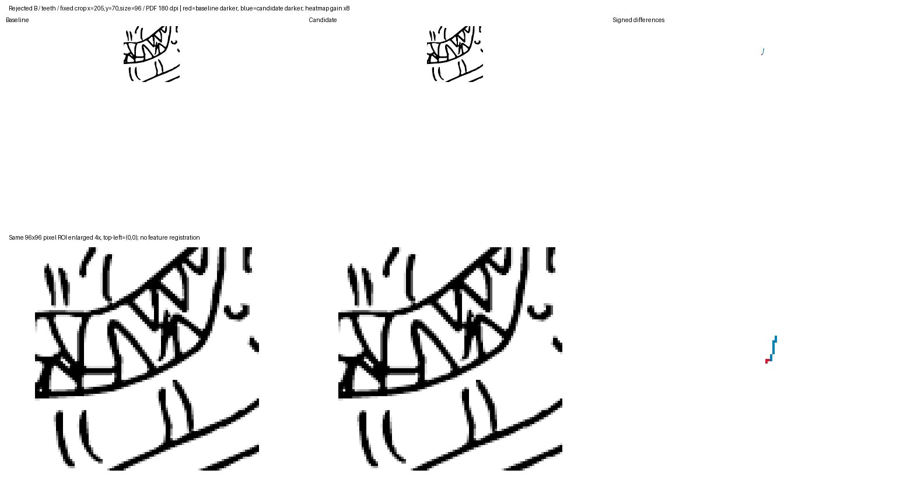
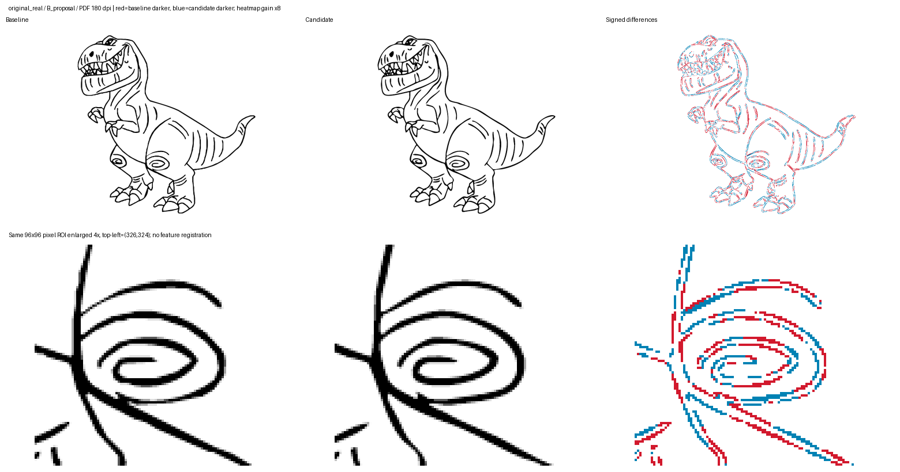
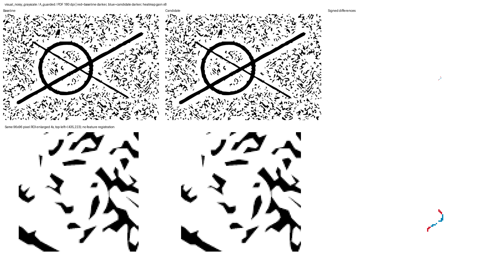

# Fase 3 — resultados e galeria

Execução `run-v1`: quatro baselines e 16 candidatos compilados. As propostas brutas ficam registradas como rejeitadas. Nenhuma saída altera o aplicativo.

| Caso | Estratégia / variante | Coordenadas | Bytes TikZ | Segmentos | Redução coord. | IoU SVG / PDF | Decisão |
| --- | --- | ---: | ---: | ---: | ---: | --- | --- |
| Dinossauro | A proposal | 2010 → 3936 | 38121 → 86636 | 1811 → 1413 | -95.821% | 0.846195 / 0.878055 | [rejected](run-v1/original_real/A_proposal/metrics.json) |
| Dinossauro | A guarded | 2010 → 1926 | 38121 → 36597 | 1811 → 1808 | 4.179% | 0.999928 / 0.999884 | [accepted_geometry](run-v1/original_real/A_guarded/metrics.json) |
| Dinossauro | B proposal | 2010 → 2306 | 38121 → 51128 | 1811 → 862 | -14.726% | 0.840237 / 0.869666 | [rejected](run-v1/original_real/B_proposal/metrics.json) |
| Dinossauro | B guarded | 2010 → 1923 | 38121 → 36559 | 1811 → 1803 | 4.328% | 0.999522 / 0.999692 | [rejected](run-v1/original_real/B_guarded/metrics.json) |
| Cara | A proposal | 812 → 1528 | 16705 → 34599 | 715 → 622 | -88.177% | 0.851894 / 0.852747 | [rejected](run-v1/cara_existing_svg/A_proposal/metrics.json) |
| Cara | A guarded | 812 → 762 | 16705 → 15715 | 715 → 715 | 6.158% | 1.000000 / 1.000000 | [serialization_only](run-v1/cara_existing_svg/A_guarded/metrics.json) |
| Cara | B proposal | 812 → 995 | 16705 → 22509 | 715 → 434 | -22.537% | 0.854991 / 0.857237 | [rejected](run-v1/cara_existing_svg/B_proposal/metrics.json) |
| Cara | B guarded | 812 → 761 | 16705 → 15695 | 715 → 714 | 6.281% | 0.999630 / 0.999609 | [accepted_geometry](run-v1/cara_existing_svg/B_guarded/metrics.json) |
| Linear PB | A proposal | 130 → 332 | 2747 → 7661 | 112 → 114 | -155.385% | 0.900104 / 0.902366 | [rejected](run-v1/visual_line_art_bw/A_proposal/metrics.json) |
| Linear PB | A guarded | 130 → 127 | 2747 → 2687 | 112 → 112 | 2.308% | 1.000000 / 1.000000 | [serialization_only](run-v1/visual_line_art_bw/A_guarded/metrics.json) |
| Linear PB | B proposal | 130 → 136 | 2747 → 3210 | 112 → 46 | -4.615% | 0.904371 / 0.903638 | [rejected](run-v1/visual_line_art_bw/B_proposal/metrics.json) |
| Linear PB | B guarded | 130 → 127 | 2747 → 2687 | 112 → 112 | 2.308% | 1.000000 / 1.000000 | [serialization_only](run-v1/visual_line_art_bw/B_guarded/metrics.json) |
| Ruidoso | A proposal | 5790 → 7018 | 119301 → 153764 | 5014 → 4438 | -21.209% | 0.902967 / 0.906766 | [rejected](run-v1/visual_noisy_grayscale/A_proposal/metrics.json) |
| Ruidoso | A guarded | 5790 → 5236 | 119301 → 108343 | 5014 → 5011 | 9.568% | 0.999931 / 0.999957 | [accepted_geometry](run-v1/visual_noisy_grayscale/A_guarded/metrics.json) |
| Ruidoso | B proposal | 5790 → 6677 | 119301 → 146143 | 5014 → 4282 | -15.320% | 0.902274 / 0.903927 | [rejected](run-v1/visual_noisy_grayscale/B_proposal/metrics.json) |
| Ruidoso | B guarded | 5790 → 5237 | 119301 → 108354 | 5014 → 5014 | 9.551% | 1.000000 / 1.000000 | [serialization_only](run-v1/visual_noisy_grayscale/B_guarded/metrics.json) |

A comparação usa o SVG anterior ao otimizador da Fase 1. A redução de coordenadas inclui fechamentos redundantes: veja a separação no relatório técnico. `serialization_only` não é ganho geométrico.

[Relatório e protocolo](../PHASE3_REPORT.md) · [Métricas completas](run-v1/results.json) · [Ambiente e hashes](run-v1/environment.json)

## Resultados aceitos e controle negativo

Dinossauro A: três segmentos a menos, mesmas coordenadas que a simplificação lexical.

Cara B: uma reta redundante a menos, sem perder componentes ou furos nas resoluções verificadas.

Dinossauro B: rejeitado por duas regiões brancas se unirem no PDF a 180 dpi.

Proposta B sem fallback: menos segmentos, porém mais coordenadas, bytes e perda visual.

Controle ruidoso A: somente três segmentos reduzidos; a complexidade da máscara permanece.

Cada pasta de candidato contém SVG, TEX, PDF, PNG, log, mapa de diferenças, heatmap e comparação com o raster original. Os diretórios de probes ficam preservados localmente, fora do conjunto qualificado.
